<div align="center">



### Muraho! I'm Flavien 👋

IT student at AUCA in Kigali, Rwanda.<br>
This page is a small playground. Play a game, paint a tile, take a walk, or go looking for hidden flags.

</div>

---

### 🌄 Kigali right now

<!-- hills:start -->


<sub>The sky here follows the real time and weather in Kigali and updates every hour. The fireflies are the things I did on GitHub this month.</sub>
<!-- hills:end -->

---

### 🌰 Igisoro: the internet vs. my bot

Igisoro is a seed game Rwandans have played for generations, carved into wood or dug into the ground. Here, **everyone who visits plays on the same team** against a small bot I wrote. One move per click.

<!-- igisoro:start -->
<p align="center"></p>

<p align="center"><b>Your move.</b> Click a pit number to sow from it. Only pits with 2 or more seeds can be played.</p>

<table align="center">
<tr><td><sub>front row</sub></td><td align="center"><a href="https://github.com/mbishflavien/mbishflavien/issues/new?title=igisoro%7Cmove%7C16&amp;body=Just+press+%2A%2ACreate%2A%2A+below.+You+don%27t+need+to+write+anything+else."><b>16</b></a><br><sub>2 seeds</sub></td><td align="center"><a href="https://github.com/mbishflavien/mbishflavien/issues/new?title=igisoro%7Cmove%7C15&amp;body=Just+press+%2A%2ACreate%2A%2A+below.+You+don%27t+need+to+write+anything+else."><b>15</b></a><br><sub>2 seeds</sub></td><td align="center"><a href="https://github.com/mbishflavien/mbishflavien/issues/new?title=igisoro%7Cmove%7C14&amp;body=Just+press+%2A%2ACreate%2A%2A+below.+You+don%27t+need+to+write+anything+else."><b>14</b></a><br><sub>2 seeds</sub></td><td align="center"><a href="https://github.com/mbishflavien/mbishflavien/issues/new?title=igisoro%7Cmove%7C13&amp;body=Just+press+%2A%2ACreate%2A%2A+below.+You+don%27t+need+to+write+anything+else."><b>13</b></a><br><sub>2 seeds</sub></td><td align="center"><a href="https://github.com/mbishflavien/mbishflavien/issues/new?title=igisoro%7Cmove%7C12&amp;body=Just+press+%2A%2ACreate%2A%2A+below.+You+don%27t+need+to+write+anything+else."><b>12</b></a><br><sub>2 seeds</sub></td><td align="center"><a href="https://github.com/mbishflavien/mbishflavien/issues/new?title=igisoro%7Cmove%7C11&amp;body=Just+press+%2A%2ACreate%2A%2A+below.+You+don%27t+need+to+write+anything+else."><b>11</b></a><br><sub>2 seeds</sub></td><td align="center"><a href="https://github.com/mbishflavien/mbishflavien/issues/new?title=igisoro%7Cmove%7C10&amp;body=Just+press+%2A%2ACreate%2A%2A+below.+You+don%27t+need+to+write+anything+else."><b>10</b></a><br><sub>2 seeds</sub></td><td align="center"><a href="https://github.com/mbishflavien/mbishflavien/issues/new?title=igisoro%7Cmove%7C9&amp;body=Just+press+%2A%2ACreate%2A%2A+below.+You+don%27t+need+to+write+anything+else."><b>9</b></a><br><sub>2 seeds</sub></td></tr>
<tr><td><sub>back row</sub></td><td align="center"><a href="https://github.com/mbishflavien/mbishflavien/issues/new?title=igisoro%7Cmove%7C1&amp;body=Just+press+%2A%2ACreate%2A%2A+below.+You+don%27t+need+to+write+anything+else."><b>1</b></a><br><sub>2 seeds</sub></td><td align="center"><a href="https://github.com/mbishflavien/mbishflavien/issues/new?title=igisoro%7Cmove%7C2&amp;body=Just+press+%2A%2ACreate%2A%2A+below.+You+don%27t+need+to+write+anything+else."><b>2</b></a><br><sub>2 seeds</sub></td><td align="center"><a href="https://github.com/mbishflavien/mbishflavien/issues/new?title=igisoro%7Cmove%7C3&amp;body=Just+press+%2A%2ACreate%2A%2A+below.+You+don%27t+need+to+write+anything+else."><b>3</b></a><br><sub>2 seeds</sub></td><td align="center"><a href="https://github.com/mbishflavien/mbishflavien/issues/new?title=igisoro%7Cmove%7C4&amp;body=Just+press+%2A%2ACreate%2A%2A+below.+You+don%27t+need+to+write+anything+else."><b>4</b></a><br><sub>2 seeds</sub></td><td align="center"><a href="https://github.com/mbishflavien/mbishflavien/issues/new?title=igisoro%7Cmove%7C5&amp;body=Just+press+%2A%2ACreate%2A%2A+below.+You+don%27t+need+to+write+anything+else."><b>5</b></a><br><sub>2 seeds</sub></td><td align="center"><a href="https://github.com/mbishflavien/mbishflavien/issues/new?title=igisoro%7Cmove%7C6&amp;body=Just+press+%2A%2ACreate%2A%2A+below.+You+don%27t+need+to+write+anything+else."><b>6</b></a><br><sub>2 seeds</sub></td><td align="center"><a href="https://github.com/mbishflavien/mbishflavien/issues/new?title=igisoro%7Cmove%7C7&amp;body=Just+press+%2A%2ACreate%2A%2A+below.+You+don%27t+need+to+write+anything+else."><b>7</b></a><br><sub>2 seeds</sub></td><td align="center"><a href="https://github.com/mbishflavien/mbishflavien/issues/new?title=igisoro%7Cmove%7C8&amp;body=Just+press+%2A%2ACreate%2A%2A+below.+You+don%27t+need+to+write+anything+else."><b>8</b></a><br><sub>2 seeds</sub></td></tr>
</table>

<p align="center"><sub>Latest moves</sub></p>
<ul><li>No moves yet. Be the first!</li></ul>
<p align="center"><sub>Most moves: nobody yet</sub></p>
<!-- igisoro:end -->

<details>
<summary>How to play</summary>
<br>

- The bottom two rows are ours (the internet's). The top two are the bot's.
- Pick one of our pits with at least 2 seeds. Its seeds are dropped one by one around our two rows, anticlockwise, in the order of the pit numbers.
- If the last seed lands in a pit that already had seeds, pick them all up and keep going.
- If that pit is in our front row and **both** of the bot's pits facing it have seeds, we capture them and sow them again from the pit where the move began.
- The move ends when the last seed lands in an empty pit. Then the bot plays.
- Whoever can't move loses.

Families play Igisoro with small differences in the rules. This is a simplified version.
</details>

---

### 🎨 The Imigongo wall

Imigongo is the black, white and red geometric art from eastern Rwanda, first made by hand on the walls of homes. This wall is painted by visitors, one tile at a time. When all 48 tiles are done, it gets saved and a new wall starts.

<!-- mural:start -->
<p align="center"></p>

<details>
<summary><b>🖌️ Paint a tile</b> (48 left, up to 3 per person)</summary>
<br>
<table align="center">
<tr><td align="center"><a href="https://github.com/mbishflavien/mbishflavien/issues/new?title=mural%7Cpaint%7CA1&amp;body=Just+press+%2A%2ACreate%2A%2A+below.+You+don%27t+need+to+write+anything+else.">A1</a></td><td align="center"><a href="https://github.com/mbishflavien/mbishflavien/issues/new?title=mural%7Cpaint%7CB1&amp;body=Just+press+%2A%2ACreate%2A%2A+below.+You+don%27t+need+to+write+anything+else.">B1</a></td><td align="center"><a href="https://github.com/mbishflavien/mbishflavien/issues/new?title=mural%7Cpaint%7CC1&amp;body=Just+press+%2A%2ACreate%2A%2A+below.+You+don%27t+need+to+write+anything+else.">C1</a></td><td align="center"><a href="https://github.com/mbishflavien/mbishflavien/issues/new?title=mural%7Cpaint%7CD1&amp;body=Just+press+%2A%2ACreate%2A%2A+below.+You+don%27t+need+to+write+anything+else.">D1</a></td><td align="center"><a href="https://github.com/mbishflavien/mbishflavien/issues/new?title=mural%7Cpaint%7CE1&amp;body=Just+press+%2A%2ACreate%2A%2A+below.+You+don%27t+need+to+write+anything+else.">E1</a></td><td align="center"><a href="https://github.com/mbishflavien/mbishflavien/issues/new?title=mural%7Cpaint%7CF1&amp;body=Just+press+%2A%2ACreate%2A%2A+below.+You+don%27t+need+to+write+anything+else.">F1</a></td><td align="center"><a href="https://github.com/mbishflavien/mbishflavien/issues/new?title=mural%7Cpaint%7CG1&amp;body=Just+press+%2A%2ACreate%2A%2A+below.+You+don%27t+need+to+write+anything+else.">G1</a></td><td align="center"><a href="https://github.com/mbishflavien/mbishflavien/issues/new?title=mural%7Cpaint%7CH1&amp;body=Just+press+%2A%2ACreate%2A%2A+below.+You+don%27t+need+to+write+anything+else.">H1</a></td></tr><tr><td align="center"><a href="https://github.com/mbishflavien/mbishflavien/issues/new?title=mural%7Cpaint%7CA2&amp;body=Just+press+%2A%2ACreate%2A%2A+below.+You+don%27t+need+to+write+anything+else.">A2</a></td><td align="center"><a href="https://github.com/mbishflavien/mbishflavien/issues/new?title=mural%7Cpaint%7CB2&amp;body=Just+press+%2A%2ACreate%2A%2A+below.+You+don%27t+need+to+write+anything+else.">B2</a></td><td align="center"><a href="https://github.com/mbishflavien/mbishflavien/issues/new?title=mural%7Cpaint%7CC2&amp;body=Just+press+%2A%2ACreate%2A%2A+below.+You+don%27t+need+to+write+anything+else.">C2</a></td><td align="center"><a href="https://github.com/mbishflavien/mbishflavien/issues/new?title=mural%7Cpaint%7CD2&amp;body=Just+press+%2A%2ACreate%2A%2A+below.+You+don%27t+need+to+write+anything+else.">D2</a></td><td align="center"><a href="https://github.com/mbishflavien/mbishflavien/issues/new?title=mural%7Cpaint%7CE2&amp;body=Just+press+%2A%2ACreate%2A%2A+below.+You+don%27t+need+to+write+anything+else.">E2</a></td><td align="center"><a href="https://github.com/mbishflavien/mbishflavien/issues/new?title=mural%7Cpaint%7CF2&amp;body=Just+press+%2A%2ACreate%2A%2A+below.+You+don%27t+need+to+write+anything+else.">F2</a></td><td align="center"><a href="https://github.com/mbishflavien/mbishflavien/issues/new?title=mural%7Cpaint%7CG2&amp;body=Just+press+%2A%2ACreate%2A%2A+below.+You+don%27t+need+to+write+anything+else.">G2</a></td><td align="center"><a href="https://github.com/mbishflavien/mbishflavien/issues/new?title=mural%7Cpaint%7CH2&amp;body=Just+press+%2A%2ACreate%2A%2A+below.+You+don%27t+need+to+write+anything+else.">H2</a></td></tr><tr><td align="center"><a href="https://github.com/mbishflavien/mbishflavien/issues/new?title=mural%7Cpaint%7CA3&amp;body=Just+press+%2A%2ACreate%2A%2A+below.+You+don%27t+need+to+write+anything+else.">A3</a></td><td align="center"><a href="https://github.com/mbishflavien/mbishflavien/issues/new?title=mural%7Cpaint%7CB3&amp;body=Just+press+%2A%2ACreate%2A%2A+below.+You+don%27t+need+to+write+anything+else.">B3</a></td><td align="center"><a href="https://github.com/mbishflavien/mbishflavien/issues/new?title=mural%7Cpaint%7CC3&amp;body=Just+press+%2A%2ACreate%2A%2A+below.+You+don%27t+need+to+write+anything+else.">C3</a></td><td align="center"><a href="https://github.com/mbishflavien/mbishflavien/issues/new?title=mural%7Cpaint%7CD3&amp;body=Just+press+%2A%2ACreate%2A%2A+below.+You+don%27t+need+to+write+anything+else.">D3</a></td><td align="center"><a href="https://github.com/mbishflavien/mbishflavien/issues/new?title=mural%7Cpaint%7CE3&amp;body=Just+press+%2A%2ACreate%2A%2A+below.+You+don%27t+need+to+write+anything+else.">E3</a></td><td align="center"><a href="https://github.com/mbishflavien/mbishflavien/issues/new?title=mural%7Cpaint%7CF3&amp;body=Just+press+%2A%2ACreate%2A%2A+below.+You+don%27t+need+to+write+anything+else.">F3</a></td><td align="center"><a href="https://github.com/mbishflavien/mbishflavien/issues/new?title=mural%7Cpaint%7CG3&amp;body=Just+press+%2A%2ACreate%2A%2A+below.+You+don%27t+need+to+write+anything+else.">G3</a></td><td align="center"><a href="https://github.com/mbishflavien/mbishflavien/issues/new?title=mural%7Cpaint%7CH3&amp;body=Just+press+%2A%2ACreate%2A%2A+below.+You+don%27t+need+to+write+anything+else.">H3</a></td></tr><tr><td align="center"><a href="https://github.com/mbishflavien/mbishflavien/issues/new?title=mural%7Cpaint%7CA4&amp;body=Just+press+%2A%2ACreate%2A%2A+below.+You+don%27t+need+to+write+anything+else.">A4</a></td><td align="center"><a href="https://github.com/mbishflavien/mbishflavien/issues/new?title=mural%7Cpaint%7CB4&amp;body=Just+press+%2A%2ACreate%2A%2A+below.+You+don%27t+need+to+write+anything+else.">B4</a></td><td align="center"><a href="https://github.com/mbishflavien/mbishflavien/issues/new?title=mural%7Cpaint%7CC4&amp;body=Just+press+%2A%2ACreate%2A%2A+below.+You+don%27t+need+to+write+anything+else.">C4</a></td><td align="center"><a href="https://github.com/mbishflavien/mbishflavien/issues/new?title=mural%7Cpaint%7CD4&amp;body=Just+press+%2A%2ACreate%2A%2A+below.+You+don%27t+need+to+write+anything+else.">D4</a></td><td align="center"><a href="https://github.com/mbishflavien/mbishflavien/issues/new?title=mural%7Cpaint%7CE4&amp;body=Just+press+%2A%2ACreate%2A%2A+below.+You+don%27t+need+to+write+anything+else.">E4</a></td><td align="center"><a href="https://github.com/mbishflavien/mbishflavien/issues/new?title=mural%7Cpaint%7CF4&amp;body=Just+press+%2A%2ACreate%2A%2A+below.+You+don%27t+need+to+write+anything+else.">F4</a></td><td align="center"><a href="https://github.com/mbishflavien/mbishflavien/issues/new?title=mural%7Cpaint%7CG4&amp;body=Just+press+%2A%2ACreate%2A%2A+below.+You+don%27t+need+to+write+anything+else.">G4</a></td><td align="center"><a href="https://github.com/mbishflavien/mbishflavien/issues/new?title=mural%7Cpaint%7CH4&amp;body=Just+press+%2A%2ACreate%2A%2A+below.+You+don%27t+need+to+write+anything+else.">H4</a></td></tr><tr><td align="center"><a href="https://github.com/mbishflavien/mbishflavien/issues/new?title=mural%7Cpaint%7CA5&amp;body=Just+press+%2A%2ACreate%2A%2A+below.+You+don%27t+need+to+write+anything+else.">A5</a></td><td align="center"><a href="https://github.com/mbishflavien/mbishflavien/issues/new?title=mural%7Cpaint%7CB5&amp;body=Just+press+%2A%2ACreate%2A%2A+below.+You+don%27t+need+to+write+anything+else.">B5</a></td><td align="center"><a href="https://github.com/mbishflavien/mbishflavien/issues/new?title=mural%7Cpaint%7CC5&amp;body=Just+press+%2A%2ACreate%2A%2A+below.+You+don%27t+need+to+write+anything+else.">C5</a></td><td align="center"><a href="https://github.com/mbishflavien/mbishflavien/issues/new?title=mural%7Cpaint%7CD5&amp;body=Just+press+%2A%2ACreate%2A%2A+below.+You+don%27t+need+to+write+anything+else.">D5</a></td><td align="center"><a href="https://github.com/mbishflavien/mbishflavien/issues/new?title=mural%7Cpaint%7CE5&amp;body=Just+press+%2A%2ACreate%2A%2A+below.+You+don%27t+need+to+write+anything+else.">E5</a></td><td align="center"><a href="https://github.com/mbishflavien/mbishflavien/issues/new?title=mural%7Cpaint%7CF5&amp;body=Just+press+%2A%2ACreate%2A%2A+below.+You+don%27t+need+to+write+anything+else.">F5</a></td><td align="center"><a href="https://github.com/mbishflavien/mbishflavien/issues/new?title=mural%7Cpaint%7CG5&amp;body=Just+press+%2A%2ACreate%2A%2A+below.+You+don%27t+need+to+write+anything+else.">G5</a></td><td align="center"><a href="https://github.com/mbishflavien/mbishflavien/issues/new?title=mural%7Cpaint%7CH5&amp;body=Just+press+%2A%2ACreate%2A%2A+below.+You+don%27t+need+to+write+anything+else.">H5</a></td></tr><tr><td align="center"><a href="https://github.com/mbishflavien/mbishflavien/issues/new?title=mural%7Cpaint%7CA6&amp;body=Just+press+%2A%2ACreate%2A%2A+below.+You+don%27t+need+to+write+anything+else.">A6</a></td><td align="center"><a href="https://github.com/mbishflavien/mbishflavien/issues/new?title=mural%7Cpaint%7CB6&amp;body=Just+press+%2A%2ACreate%2A%2A+below.+You+don%27t+need+to+write+anything+else.">B6</a></td><td align="center"><a href="https://github.com/mbishflavien/mbishflavien/issues/new?title=mural%7Cpaint%7CC6&amp;body=Just+press+%2A%2ACreate%2A%2A+below.+You+don%27t+need+to+write+anything+else.">C6</a></td><td align="center"><a href="https://github.com/mbishflavien/mbishflavien/issues/new?title=mural%7Cpaint%7CD6&amp;body=Just+press+%2A%2ACreate%2A%2A+below.+You+don%27t+need+to+write+anything+else.">D6</a></td><td align="center"><a href="https://github.com/mbishflavien/mbishflavien/issues/new?title=mural%7Cpaint%7CE6&amp;body=Just+press+%2A%2ACreate%2A%2A+below.+You+don%27t+need+to+write+anything+else.">E6</a></td><td align="center"><a href="https://github.com/mbishflavien/mbishflavien/issues/new?title=mural%7Cpaint%7CF6&amp;body=Just+press+%2A%2ACreate%2A%2A+below.+You+don%27t+need+to+write+anything+else.">F6</a></td><td align="center"><a href="https://github.com/mbishflavien/mbishflavien/issues/new?title=mural%7Cpaint%7CG6&amp;body=Just+press+%2A%2ACreate%2A%2A+below.+You+don%27t+need+to+write+anything+else.">G6</a></td><td align="center"><a href="https://github.com/mbishflavien/mbishflavien/issues/new?title=mural%7Cpaint%7CH6&amp;body=Just+press+%2A%2ACreate%2A%2A+below.+You+don%27t+need+to+write+anything+else.">H6</a></td></tr>
</table>
</details>

<p align="center"><sub>Recently painted by nobody yet</sub></p>
<!-- mural:end -->

---

### 🗺️ A short walk through Kigali

<details>
<summary><b>🌅 You land in Kigali at sunrise. A note in your pocket says: "Find Flavien." (click to start)</b></summary>
<br>

The streets are clean, the hills are green, and two moto drivers wave at you.

<details>
<summary>🏍️ "Take me up to the university."</summary>
<br>

You ride up to AUCA. A student by the gate says Flavien was just here, talking about a lock that opens when you clap.

<details>
<summary>👏 "A lock that opens when you clap?"</summary>
<br>

"It's real," the student laughs. A small board listens for a clapping rhythm, a model checks whether it's the right one, and a little motor turns the lock. It scored 95 in class. You can look at it here: [ai-iot-clap-lock](https://github.com/mbishflavien/ai-iot-clap-lock).

"But Flavien already left. Try the market."

</details>

<details>
<summary>📚 Walk into the library instead</summary>
<br>

Notebooks everywhere: project management, security, testing, networks, Linux. Taped inside one cover is a strange scribble:

`synt{gubhfnaq_uvyyf}`

The letters look like they slid a little. You copy it down, just in case.

</details>
</details>

<details>
<summary>🛍️ "Take me to Kimironko market."</summary>
<br>

Fruit, fabric and noise. A vendor says Flavien came by asking how minerals are followed from the mine to the buyer, and said something about a map that shows the whole journey.

<details>
<summary>🚌 Jump on the next bus</summary>
<br>

Halfway up the road, someone is testing a bus booking app on a phone with their teammates. They look up.

"You found me! 👋 Thanks for walking around. [Say hi](https://github.com/mbishflavien/mbishflavien/issues/new?title=Hello%20from%20the%20walk) if you like."

**The end.**

</details>

<details>
<summary>🌰 Sit with the old man playing Igisoro</summary>
<br>

He doesn't look up. "Flavien plays too, but never beats me." He points at the board above this story. "Go on. The internet needs you."

</details>
</details>
</details>

---

### 🚩 Three flags

<!-- ctf:start -->
<p align="center">There are <b>3 flags</b> hidden in this profile. They look like <code>flag{...}</code>.</p>

<details>
<summary>Hints</summary>
<ol><li>The portrait is keeping a note it never draws.</li><li>Walk slowly through Kigali. Someone left a scribble in a notebook, and the letters look shifted.</li><li>Even the sky over the hills keeps a secret, written in a way only computers enjoy reading.</li></ol>
</details>

<details>
<summary>Found one? Here's how to submit it</summary>
<br>

So nobody can copy your answer from the issues, you send a hash of your login and the flag instead of the flag:

```bash
echo -n "yourlogin:flag{...}" | sha256sum
```

Then <a href="https://github.com/mbishflavien/mbishflavien/issues/new?title=ctf%7CPASTE_YOUR_HASH_HERE&amp;body=Replace+PASTE_YOUR_HASH_HERE+in+the+title+with+your+hash%2C+then+press+Create.">open a submission</a> and put the hash in the title, like `ctf|3f9a...`.
</details>

<h4 align="center">🏆 Hall of Hackers</h4>
<p align="center"><sub>No one has found a flag yet.</sub></p>
<!-- ctf:end -->

<p align="center"><sub>Everything on this page is redrawn by small Python scripts in <a href="scripts">scripts/</a> and GitHub Actions.</sub></p>
