<div align="center">

<picture>
  <source media="(prefers-color-scheme: dark)" srcset="assets/hero-dark.svg">
  
</picture>

<picture>
  <source media="(prefers-color-scheme: dark)" srcset="assets/strip-dark.svg">
  
</picture>

Muraho! 👋 I'm a software developer from **Kigali, Rwanda**.<br>
I build full-stack web and mobile apps, train small machine learning models,<br>
and like knowing how systems break so I can build them to hold.

</div>

### 🧭 About me

- 🛠️ Building **IntoreAI**, a talent screening platform that ranks applicants with a scoring engine you can explain.
- 🗺️ Working on a mineral traceability platform that follows minerals from the mine to the buyer on a 3D map.
- 🔐 Into security testing: vulnerability assessment and penetration testing labs, and software testing (ISTQB).
- 🔌 Like mixing software with hardware: my clap-rhythm door lock pairs a Python ML model with a FastAPI service and an ESP32.
- 🌱 Learning Go on the A2SV backend track.

### 🧰 Tech I use

| | |
|---|---|
| **Languages** | TypeScript · JavaScript · Python · Java · Dart · Go · C# · SQL / PL/SQL · PHP |
| **Frontend** | React · Next.js · Vite · CesiumJS · HTML/CSS |
| **Backend** | Node.js / Express · FastAPI · Spring Boot · GraphQL · RabbitMQ · REST APIs |
| **Mobile** | Flutter · Firebase (Auth, Firestore) |
| **Data & AI** | scikit-learn · LLM APIs (Gemini) · MCP servers |
| **Databases** | MySQL · Oracle · Firestore |
| **Tools** | Git & GitHub Actions · Docker · Linux · Postman · Codespaces |
| **Security** | Vulnerability assessment & pentesting · Software testing (ISTQB) |
| **Hardware** | ESP32 · Arduino |

### 🚀 Things I've built

| Project | What it is | Built with |
|---|---|---|
| [**IntoreAI**](https://github.com/mbishflavien/intore-ai) | AI talent screening: ranks applicants against a job, with scores you can explain | TypeScript · Python |
| [**CyberGuard**](https://github.com/mbishflavien/CyberGuard-Frontend) | Frontend for an AI-native cybersecurity platform built for Africa | TypeScript · React |
| [**Simba Supermarket**](https://github.com/mbishflavien/simba_2) | E-commerce app with cart, branch map and an AI shopping assistant | TypeScript |
| [**VRMS**](https://github.com/mbishflavien/Vehicle-Rental-Management-System) | Vehicle rental platform; every booking emails and texts the customer through RabbitMQ | Java · Spring Boot · React |
| [**MoMo Wallet**](https://github.com/mbishflavien/momo-wallet) | Mobile-money wallet: receive, send and cash out | Flutter · Firebase |
| [**Kigali Weather**](https://github.com/mbishflavien/kigali-weather-app) | Live weather for four Rwandan cities | Flutter · Open-Meteo |
| [**CareConnect**](https://github.com/mbishflavien/mbishibishi_flavien_27857_plsql_capstone_project) | Healthcare information system with the business logic inside the database | Oracle PL/SQL |
| **Clap Lock** | A door lock that opens to the right clap rhythm (scored 95) | Python · FastAPI · ESP32 |

### 📊 GitHub at a glance

<!-- stats:start -->
<picture>
  <source media="(prefers-color-scheme: dark)" srcset="assets/stats-dark.svg?v=1794683265">
  
</picture>
<!-- stats:end -->

<picture>
  <source media="(prefers-color-scheme: dark)" srcset="assets/strip-dark.svg">
  
</picture>

### 🌄 Kigali right now

<!-- hills:start -->


<sub>The sky here follows the real time and weather in Kigali and updates every hour. The fireflies are the things I did on GitHub this month.</sub>
<!-- hills:end -->

### 🗺️ A short walk through Kigali

<details>
<summary><b>🌅 You land in Kigali at sunrise. A note in your pocket says: "Find Flavien." (click to start)</b></summary>
<br>

The streets are clean, the hills are green, and two moto drivers wave at you.

<details>
<summary>🏍️ "Take me up to the university."</summary>
<br>

You ride up to the campus. A student by the gate says Flavien was just here, talking about a lock that opens when you clap.

<details>
<summary>👏 "A lock that opens when you clap?"</summary>
<br>

"It's real," the student laughs. A small board listens for a clapping rhythm, a model checks whether it's the right one, and a little motor turns the lock.

"But Flavien already left. Try the market."

</details>

<details>
<summary>📚 Walk into the library instead</summary>
<br>

Notebooks everywhere: project management, security, testing, networks, Linux. Taped inside one cover is a strange scribble:

`synt{gubhfnaq_uvyyf}`

The letters look like they slid a little. You copy it down, just in case.

</details>
</details>

<details>
<summary>🛍️ "Take me to Kimironko market."</summary>
<br>

Fruit, fabric and noise. A vendor says Flavien came by asking how minerals are followed from the mine to the buyer, and said something about a map that shows the whole journey.

<details>
<summary>🚌 Jump on the next bus</summary>
<br>

Halfway up the road, someone is testing a bus booking app on a phone with their teammates. They look up.

"You found me! 👋 Thanks for walking around. [Say hi](https://github.com/mbishflavien/mbishflavien/issues/new?title=Hello%20from%20the%20walk) if you like."

**The end.**

</details>

<details>
<summary>☕ Stop at a café first</summary>
<br>

On the next table, a laptop is open with a pull request half-reviewed and a phone app running in an emulator. The owner has just stepped out.

You wait. The coffee is excellent. Rwanda grows some of the best.

When Flavien comes back: "Oh! You found me. 👋 Want to see what I'm building? Scroll up." **The end.**

</details>
</details>
</details>

### 🚩 Three flags

<!-- ctf:start -->
<p align="center">There are <b>3 flags</b> hidden in this profile. They look like <code>flag{...}</code>.</p>

<details>
<summary>Hints</summary>
<ol><li>The portrait is keeping a note it never draws.</li><li>Walk slowly through Kigali. Someone left a scribble in a notebook, and the letters look shifted.</li><li>Even the sky over the hills keeps a secret, written in a way only computers enjoy reading.</li></ol>
</details>

<details>
<summary>Found one? Here's how to submit it</summary>
<br>

So nobody can copy your answer from the issues, you send a hash of your login and the flag instead of the flag:

```bash
echo -n "yourlogin:flag{...}" | sha256sum
```

Then <a href="https://github.com/mbishflavien/mbishflavien/issues/new?title=ctf%7CPASTE_YOUR_HASH_HERE&amp;body=Replace+PASTE_YOUR_HASH_HERE+in+the+title+with+your+hash%2C+then+press+Create.">open a submission</a> and put the hash in the title, like `ctf|3f9a...`.
</details>

<h4 align="center">🏆 Hall of Hackers</h4>
<p align="center"><sub>No one has found a flag yet.</sub></p>
<!-- ctf:end -->

<picture>
  <source media="(prefers-color-scheme: dark)" srcset="assets/strip-dark.svg">
  
</picture>

<p align="center"><sub>Everything on this page is drawn by small Python scripts in <a href="scripts">scripts/</a> and kept fresh by GitHub Actions.</sub></p>
